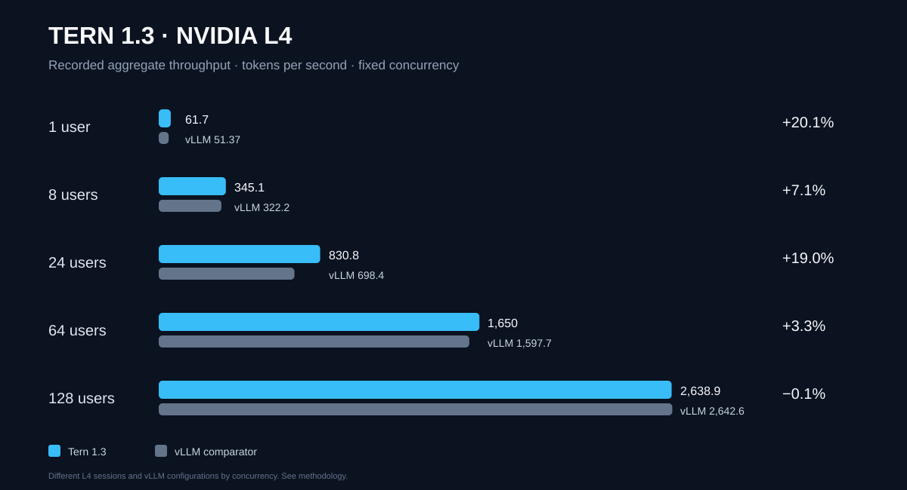
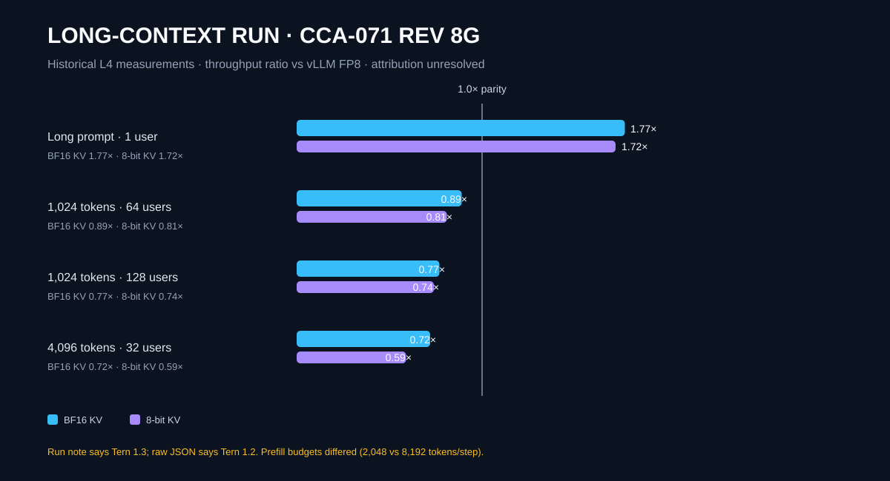

# Tern 1.3 and CCA — inference benchmark results

I use this repository to publish what I am measuring as I work on Tern and the wider CCA inference research. I keep Tern release benchmarks separate from CCA engine experiments; a result from one is not automatically a result for the other. I will keep adding runs, including the conditions, quality readings and anything that limits what the numbers can tell us. This is the evidence, not the implementation.

## CCA-042: own-kernel research result

**A separate CCA research campaign. These are not the Tern 1.3 fixed-concurrency release results.**

**CCA-042 · NVIDIA L4 · Qwen2.5-7B-Instruct · 24 concurrent requests**

| Workload | Throughput vs vLLM BF16 | Energy reduction | Quality gate |
|---|---:|---:|---:|
| Chat | **1.63×** | **39.6%** | 0.987 pass |
| Summarisation | **1.57×** | **36.7%** | 0.987 pass |
| **RAG** | **1.53×** | **35.2%** | **0.987 pass** |
| Long generation | **1.61×** | **37.8%** | 0.987 pass |
| Mixed workload | **1.52×** | **34.5%** | 0.987 pass |

On RAG, that is **129 vs 199 J per 1,000 tokens**. Energy is measured at the GPU board, not across the full system or facility. The quality gate is the measure recorded by this campaign; its definition is in the underlying research record. Of the results published here, this is the strongest combination of throughput, energy and recorded quality. I still want to repeat it on the same card before drawing a firm conclusion.

## Tern 1.3 fixed-concurrency performance

| Concurrent users | Tern 1.3 | vLLM comparator | Difference | Tern quality gate |
|---:|---:|---:|---:|---:|
| 1 | **61.7 tok/s** | 51.37 | **+20.1%** | 0.9757 stepwise / 0.9748 prefill |
| 8 | **345.1 tok/s** | 322.2 | **+7.1%** | 0.9839 |
| 24 | **830.8 tok/s** | 698.4 | **+19.0%** | 0.9826 |
| 64 | **1,650.0 tok/s** | 1,597.7 | **+3.3%** | 0.9800 |
| 128 | **2,638.9 tok/s** | 2,642.6 | **−0.1%** | 0.9839 |

I measured each Tern/vLLM pair over three interleaved rounds on the same L4 card/session. The five concurrency points came from separate sessions/cards, so this is not one continuous scaling curve. I also changed the vLLM configuration at different concurrency levels. These are results for the workloads and conditions tested, not a claim that Tern is universally faster.

## Other results

- **CCA-071 128-user validation (separate campaign):** CCA-071 records 2,438.7 tok/s, quality gate 0.9826, 29 J per 1,000 tokens and estimated GPU cost of $0.055 per million tokens. The Tern 1.2 control records 1,797.5 tok/s, 0.9831, 40 J and $0.074. That works out to approximately 35.7% more throughput, 27.5% lower energy intensity and 25.7% lower estimated token cost. This is not the 128-user result in the fixed-concurrency table above. The campaign spans more than one L4 session/card; I want a same-card repeat before treating it as a definitive comparison.
- **Kernel scheduling:** CCA-071 records a 14.0–22.9% throughput improvement across 1, 8, 24, 64 and 128 rows over three interleaved rounds, with outputs recorded as identical. This is an ablation within Tern, not a vLLM comparison.
- **6-bit KV:** CCA-043 records 0.981 top-1 agreement and 37.5% of the FP16 KV footprint in a fresh-prompt CPU evaluation. That is a memory and quality result, not evidence of faster GPU inference. The 4-bit KV variants failed that campaign's quality gate.
- **INT4:** Some CCA-042 INT4 runs had attractive throughput, but their recorded quality gates were approximately 0.896–0.927. I do not count them as quality-preserving wins.

## RAG research signal: speed gained, quality not preserved

In the earlier CCA-035 A100 SCI experiment, throughput reached **162.91 tok/s vs 26.02 tok/s** for the CCA baseline (**6.26×**). Energy intensity fell from **5,792.6 to 1,091.3 J per 1,000 tokens** (**81.2% lower**). Mean board power was 177.8 W vs 150.7 W. But exact-greedy agreement was only **45.8%**. That makes this a strong performance and energy signal to investigate, not a quality-cleared result.

In the same A100 campaign, GSR preserved exact output agreement across chat, summarisation, RAG and long generation, but the throughput and energy changes were small. SCI delivered the large speed and energy gains; it did not preserve exact outputs. These A100 measurements are separate from the L4 CCA-042 campaign and should not be read as one comparison.

## Long-context results

In the CCA-071 long-context run, the single long-prompt result was 51.4 tok/s with BF16 KV and 50.1 tok/s with 8-bit KV, against 29.1 tok/s for the vLLM FP8 comparator. All three single-user quality gates passed. At the multi-user loads tested, both Tern-labelled variants were behind vLLM.

**There is a version-attribution problem I have not resolved:** the experiment note says Tern 1.3, but the raw JSON identifies the arm/profile/label as Tern 1.2. The run also used different prefill budgets (2,048 tokens/step for Tern; 8,192 for vLLM). Until I reconcile the version and conditions, I treat the cross-framework comparison as descriptive.

## Where I want to take the benchmarks

I want to build this into a much broader record: different GPU cards and generations, different memory capacities, and a wider range of model families and sizes. The current results are only a start.

The work I want to do next is:

1. Have other operators reproduce the strongest results independently.
2. Run matched comparisons on the same physical card, measuring quality, throughput and energy for both systems under the same workload.
3. Extend the tests across more GPU types, memory capacities, hardware generations and model sizes.
4. Keep a record of each run: how it was done, what it measured, what its limitations are, and whether anyone else has reproduced it.

GPU time is currently a constraint on both sides of this work. It limits how many benchmarks I can run, but also how far I can push discovery: exploring configurations, testing ideas and following an interesting result far enough to establish whether it holds. More sustained access would let me do both the exploratory work and the systematic validation. What is published here is not yet a picture of the full research or hardware landscape.

## Looking for collaborators

I am interested in hearing from people who would like to help take this work further. In particular, I would welcome a small team with experience in GPU systems, inference runtimes, kernel engineering, quantisation and rigorous benchmarking.

There is still plenty to discover and prove. I want to improve the results, test them properly across more hardware and models, and work out what it would take to turn the research into a robust, commercially viable project. If that kind of challenge interests you, I'd be glad to compare notes and explore what we could build together.

## What I am investigating

- **The CCU memory wall:** how VRAM capacity, memory bandwidth, KV-cache growth, context length, temporary activations and state residency interact as concurrent sequences increase.
- **Kernel optimisation:** reducing data movement and overhead, getting more reuse from data, and balancing matrix and attention work against on-chip resources.
- **1–4 bit precision:** shrinking model state and data movement without losing the numerical stability, output quality or execution speed needed under real workloads.

These are research directions, not descriptions of Tern's implementation. I am not publishing representation formats, calibration or fitting methods, packing, arithmetic, kernel designs, compiler, runtime or execution path here.

## Evidence and methodology

- [METHODOLOGY.md](METHODOLOGY.md) — how I ran the tests and how I interpret them
- [CLAIMS-AND-LIMITATIONS.md](CLAIMS-AND-LIMITATIONS.md) — what these results do and do not support
- [Fixed-concurrency and historical random-arrival results](results/tern-1.3/)
- [Long-context experiment data and provenance warning](results/long-context/)

The random-arrival results are historical. I would want a fresh retest before using them as evidence of current performance. None of the results here has been independently replicated.

## Rights

This repository is open to view, not to reuse. I have not granted a licence to copy, modify, distribute or commercially exploit materials I own. See [RIGHTS-AND-USE.md](RIGHTS-AND-USE.md).