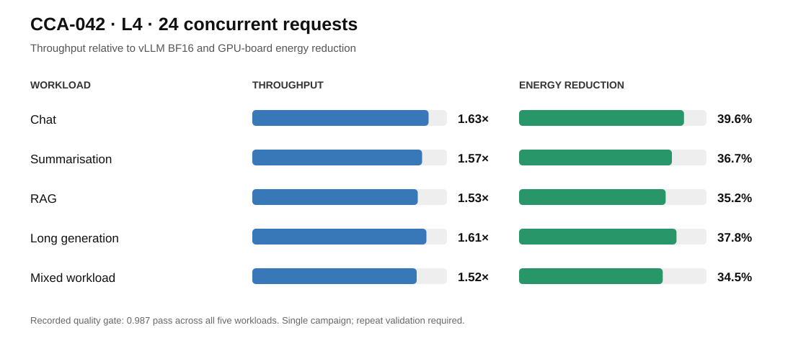

# CCA inference research — results, evidence and open questions

I am investigating ways to make GPU inference faster, more efficient and more accessible. The work spans the CCU memory wall, kernel execution and scheduling, and low-bit precision. This repository is a record of selected results I can currently share. It is not the implementation, and it is not a claim that the research is finished.

I've found some promising results and put the measurements I can share in this repository. I've also included the runs that fell short and the problems I haven't resolved. I'd like to work with people who can reproduce the results, challenge the approach and help take the research further.

## Read this before interpreting the numbers

The figures below come from specific experiments, with the conditions and gaps noted alongside them. They are not universal comparisons, and they have not been independently reproduced.

- **CCA and Tern are different strands of work.** CCA-042 is an own-kernel research campaign. The fixed-concurrency table is a Tern 1.3 release comparison. I do not attribute one set of results to the other.
- **The vLLM baseline changes.** In the fixed-concurrency Tern comparison, vLLM used GPTQ-Int8 + EAGLE-3 at 1 and 8 users, FP8 + draft at 24, and FP8 at 64 and 128. These are not comparisons against one fixed baseline.
- **The sessions differ.** Each Tern/vLLM pair was interleaved over three rounds on the same L4 card/session, but the concurrency points came from separate sessions/cards. This is not a single-card scaling sweep.
- **The quality readings are not yet independently interpretable.** The published values are campaign-recorded gate scores. I have not published the complete scoring definition, reference outputs, evaluation set, token counts and aggregation needed to interpret or reproduce them. I have also not published corresponding vLLM-side scores for the fixed-concurrency comparison. I therefore do not present these values as a common quality comparison.
- **The evidence package is incomplete.** It contains selected aggregate CSV/JSON results and methodology notes, not the complete harness, raw per-request traces, environment manifests or all run artefacts. No result here has been independently replicated.

Some of these results may not hold up under a more controlled test. That is part of what I want to find out.

## CCA-042 — own-kernel research campaign

**NVIDIA L4 · Qwen2.5-7B-Instruct · 24 concurrent requests**

| Workload | Throughput vs vLLM BF16 | GPU-board energy reduction | Recorded campaign gate |
|---|---:|---:|---:|
| Chat | **1.63×** | **39.6%** | 0.987 |
| Summarisation | **1.57×** | **36.7%** | 0.987 |
| RAG | **1.53×** | **35.2%** | 0.987 |
| Long generation | **1.61×** | **37.8%** | 0.987 |
| Mixed workload | **1.52×** | **34.5%** | 0.987 |

For RAG, the recorded energy was 129 vs 199 J per 1,000 tokens. Energy is GPU-board energy, not whole-system or facility energy.

These are the strongest combined throughput and energy readings in the evidence I can currently publish. The comparator is vLLM BF16; this is not a comparison against vLLM FP8 or a claim of superiority over the strongest available serving configuration. The campaign's gate score is reproduced as recorded, but its full definition and evaluation artefacts are not in this repository. I have not yet repeated the campaign on the same physical card under a fully documented, independently reproducible setup. Treat these as promising measurements to investigate, not settled proof of a quality-preserving advantage.

## Tern 1.3 — fixed-concurrency measurements

| Concurrent users | Tern 1.3 | Selected vLLM comparator | Difference | Tern recorded gate |
|---:|---:|---:|---:|---:|
| 1 | **61.7 tok/s** | 51.37 | **+20.1%** | 0.9757 stepwise / 0.9748 prefill |
| 8 | **345.1 tok/s** | 322.2 | **+7.1%** | 0.9839 |
| 24 | **830.8 tok/s** | 698.4 | **+19.0%** | 0.9826 |
| 64 | **1,650.0 tok/s** | 1,597.7 | **+3.3%** | 0.9800 |
| 128 | **2,638.9 tok/s** | 2,642.6 | **−0.1%** | 0.9839 |

Throughput is aggregate tokens per second, not per-user throughput. Each pair was measured in three interleaved rounds on the same L4 card/session. The concurrency points came from separate sessions/cards, and the vLLM configuration changed by row. At 128 users, the selected vLLM comparator was marginally faster. The table records what happened in those tests; it does not establish that Tern is generally faster than vLLM.

The Tern gate values are campaign records, not independently interpretable accuracy scores. The scoring definition and comparator-side quality measurements are not included, so this table is not a common quality-adjusted comparison.

## Historical random-arrival result — including the difficult part

A separate historical CCA-071 Poisson-arrival report is included in the CSV. It is important not to hide the high-load behaviour:

| Arrival rate | vLLM aggregate throughput | Tern aggregate throughput | Other recorded behaviour |
|---:|---:|---:|---|
| 2.7 req/s | 339.6 tok/s | ~342.1 tok/s | Tern TPOT 26.1–26.6 ms; vLLM 35.1 ms |
| 6.2 req/s | 783.4 tok/s | ~786.7 tok/s | Tern TPOT 43.7–44.4 ms; vLLM 37.5 ms |
| 12.8 req/s | 1,644 tok/s | 1,539.9–1,623.6 tok/s | Tern TTFT 1.51–7.05 s across rounds; vLLM ~0.17 s |
| 20.6 req/s | 2,396.8–2,420.2 tok/s | 1,808.4–2,135.3 tok/s | Tern at 0.75–0.88× vLLM throughput; queue/in-flight count grew from 515 to 780 |

This is historical evidence, not a current-release benchmark. The high-load result is a real limitation in the record: throughput fell behind the comparator and the queue/in-flight count grew substantially. At 12.8 req/s, Tern's recorded TTFT was also materially worse and varied widely between rounds. No quality-gate reading was recorded for this experiment. I need to rerun it with a complete, matched measurement setup before drawing conclusions about current behaviour.

## Other research results

- **CCA-071 128-user validation (separate campaign):** CCA-071 records 2,438.7 tok/s, a campaign gate of 0.9826, 29 J per 1,000 tokens and estimated GPU cost of $0.055 per million tokens. Its Tern 1.2 control records 1,797.5 tok/s, 0.9831, 40 J and $0.074. The recorded difference is approximately 35.7% more throughput, 27.5% lower energy intensity and 25.7% lower estimated token cost. This campaign spans more than one L4 session/card; the quality score is not fully defined in this repository. I want a same-card repeat before treating it as a firm comparison.
- **Kernel scheduling:** CCA-071 records a 14.0–22.9% throughput improvement across 1, 8, 24, 64 and 128 users over three interleaved rounds, with outputs recorded as identical. This is an ablation within Tern, not a vLLM comparison.
- **6-bit KV:** CCA-043 records 0.981 top-1 agreement and 37.5% of the FP16 KV footprint in a fresh-prompt CPU evaluation. This is a memory/quality observation, not evidence of faster GPU inference. The 4-bit KV variants failed that campaign's gate.
- **INT4:** Some CCA-042 INT4 runs had attractive throughput, but their recorded campaign gate values were approximately 0.896–0.927. I do not count them as quality-preserving wins.
- **CCA-035 A100 SCI experiment:** throughput reached 162.91 tok/s vs 26.02 tok/s for the CCA baseline (6.26×), and recorded energy intensity fell from 5,792.6 to 1,091.3 J per 1,000 tokens (81.2% lower). Mean board power was 177.8 W vs 150.7 W. Exact-greedy agreement was only 45.8%. This is a performance/energy signal, not a quality-cleared result.
- **CCA-035 A100 GSR:** exact output agreement was recorded across chat, summarisation, RAG and long generation, but throughput and energy changes were small. This is separate from the L4 CCA-042 campaign.

## Long-context results — unresolved attribution, not a headline win

The historical CCA-071 long-context experiment is retained with its own data and caveats in [results/long-context/](results/long-context/). The single-user long-prompt result recorded 51.4 tok/s with BF16 KV and 50.1 tok/s with 8-bit KV, against 29.1 tok/s for the vLLM FP8 arm. At the multi-user loads tested, both Tern-labelled variants were behind vLLM.

There are two material limitations. First, the run note says Tern 1.3 but the raw JSON identifies the arm/profile/label as Tern 1.2. Second, the prefill budgets differed: 2,048 tokens per step for Tern and 8,192 for vLLM. I have not reconciled the version attribution or made this a controlled comparison. I keep it as historical descriptive evidence and exclude it from the Tern 1.3 headline.

## What is missing for independent reproduction

I have published the aggregate evidence I can currently share, but this is not yet a turnkey reproduction package. In particular, the repository does not contain:

- the complete benchmark harness and execution scripts;
- exact environment manifests, dependency locks and build identifiers for every run;
- complete prompt/workload definitions, sampling settings and seeds;
- raw per-request traces and outputs, plus hashes and run-level variance;
- a complete, public definition of each quality gate, including reference outputs, evaluation set, token counts, aggregation and threshold;
- matching quality measurements for both sides of each framework comparison.

Those are the gaps I want to close with collaborators. I do not expect anyone to treat the current tables as independently reproducible until that work is done.

## What I want to investigate next

1. Re-run the strongest CCA-042 workloads against a strong vLLM FP8 baseline on the same physical card, with matched workload, settings, quality evaluation and energy measurement.
2. Publish a precise quality-evaluation specification and apply it to both systems.
3. Make the benchmark harness, environment and workload definitions available where rights and dependencies permit.
4. Capture raw per-request traces, repeated-run distributions, latency percentiles, queue behaviour, memory use and energy.
5. Re-test random arrivals and long-context workloads, including the high-load cases where the current record is unfavourable.
6. Extend the work across GPU generations, memory capacities, model families and model sizes.

GPU time currently limits both the number of benchmarks I can run and the amount of exploratory research I can do. It constrains not just validation, but the ability to investigate configurations, test hypotheses and follow a result far enough to understand whether it holds. More sustained access and the right technical collaborators would make a material difference.

## Looking for collaborators

I am looking for people who want to help reproduce, challenge and advance this work: GPU systems engineers, inference-runtime and kernel specialists, quantisation researchers, and people with strong benchmarking discipline.

I have found some promising results. I have published the evidence I can currently share, and I have tried to be equally clear about where it falls short. The next step is to reproduce the results under tighter controls, understand which ideas hold up, and push the research further. If that is a problem you would like to work on, I would be glad to compare notes.

## What I am investigating

- **The CCU memory wall:** how VRAM capacity, memory bandwidth, KV-cache growth, context length, temporary activations and state residency interact as concurrent sequences increase.
- **Kernel optimisation:** reducing data movement and overhead, increasing data reuse, and balancing matrix and attention work against on-chip resources.
- **1–4 bit precision:** reducing model-state size and data movement without losing the numerical stability, output quality or execution speed needed under real workloads.

These are research directions, not descriptions of Tern's implementation. I am not publishing representation formats, calibration or fitting methods, packing, arithmetic, kernel designs, compiler, runtime or execution path here.

## Evidence and methodology

- [METHODOLOGY.md](METHODOLOGY.md) — test conditions, metric interpretation and known gaps
- [CLAIMS-AND-LIMITATIONS.md](CLAIMS-AND-LIMITATIONS.md) — the claims I consider supported, and the ones I do not make
- [Fixed-concurrency and historical random-arrival data](results/tern-1.3/)
- [Long-context data and provenance warning](results/long-context/)

## Rights

This repository is open to view, not to reuse. I have not granted a licence to copy, modify, distribute or commercially exploit materials I own. See [RIGHTS-AND-USE.md](RIGHTS-AND-USE.md).
